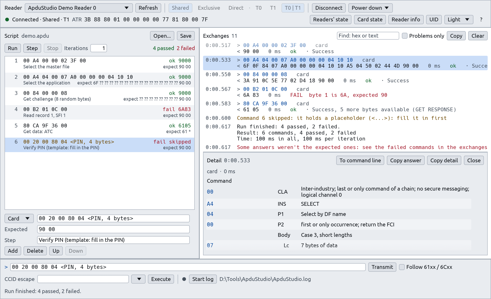

# ApduStudio

A tool for testing smart cards through PC/SC, on Windows, Linux and macOS: connect to a card, send
APDUs, run scripts that check each answer, and keep a log of everything sent and received.

Made by [Ialto](https://ialto.com) and distributed under the Apache License 2.0 (see
[Licence](#licence)).



## Download

| Where | What | Kept |
|---|---|---|
| **Releases** (one per `vX.Y.Z` tag) | `ApduStudio-windows-x64.exe` and `apdustudio-cli-windows-x64.exe`, `ApduStudio-linux-x64.tar.gz`, `ApduStudio-macos-arm64.tar.gz` (both programs in each archive) | For good |
| **Actions**, a Build (or CI with "build") run started by hand, Artifacts | The same files, in `ApduStudio-Windows`, `ApduStudio-Linux`, `ApduStudio-macOS` | 90 days |

None of them is signed:

- **Windows:** SmartScreen may warn on the first start ("More info", then "Run anyway").
- **macOS (Apple silicon):** unpack it, then remove the download's quarantine:
  `xattr -d com.apple.quarantine ApduStudio`, or Control-click it and choose Open.
- **Linux (x64):** unpack it. It needs glibc 2.28 or later: Debian 10, Ubuntu 20.04, RHEL 8 and
  their successors, or any distribution as recent (`ldd --version` shows yours). A desktop
  usually has the window's libraries already; on a minimal system, install them with the smart
  card service (`pcscd`, with the CCID driver for USB readers):

  | Distribution | Command |
  |---|---|
  | Debian, Ubuntu | `sudo apt install pcscd libccid libpcsclite1 libgl1 libegl1 libgl1-mesa-dri libxkbcommon-x11-0 libxcursor1 libxrandr2 libxi6` |
  | Fedora, RHEL, AlmaLinux, Rocky | `sudo dnf install pcsc-lite pcsc-lite-ccid mesa-libGL mesa-libEGL mesa-dri-drivers libxkbcommon-x11 libXcursor libXrandr libXi` |
  | openSUSE | `sudo zypper install pcsc-lite pcsc-ccid Mesa-libGL1 Mesa-libEGL1 Mesa-dri libxkbcommon-x11-0 libXcursor1 libXrandr2 libXi6` |
  | Arch | `sudo pacman -S pcsclite ccid mesa libxkbcommon-x11 libxcursor libxrandr libxi` |

  Then start the service: `sudo systemctl enable --now pcscd.socket`. Every build made on GitHub is started on
  AlmaLinux 8 and 9, Fedora, Debian 12 and 13, Ubuntu 20.04 to 26.04, openSUSE Leap and Arch,
  each with only the libraries of this list (not `pcscd`: the test uses the demo reader), under
  X11. Wayland, which needs `libEGL`, isn't tested yet.

To publish a release, set the version in `Cargo.toml` (the app reads it from there), merge,
then push the tag: `git tag v1.0.0 && git push origin v1.0.0`. The Release workflow refuses a
tag that doesn't match it.

The window's title shows the version; **About...** (in the help, F1) also shows the build: the
commit for an executable built by CI (`APDU_STUDIO_COMMIT`), "local build" otherwise. It names
the smart card service with its version when the system gives it, as PC/SC has no call for it:
`WinSCard.dll`'s file version on Windows, `pcscd --version` with pcsc-lite (two seconds at most),
the macOS version for PCSC.framework. It is looked up once, in the background; without it, only
the name is shown.

## Build and run

Rust (stable), then:

```sh
cargo build --release
target/release/ApduStudio [options] [script.apdu]     # target\release\ApduStudio.exe on Windows
```

The release build is a single executable with no installer (7.5 MB on Windows).

| System | Smart card service | To build |
|---|---|---|
| Windows | Built in (winscard) | Nothing more |
| Linux | pcsc-lite: the `pcscd` service and its CCID driver | `pkg-config` and `libpcsclite-dev` (Debian, Ubuntu), `pcsc-lite-devel` (Fedora), `pcsclite` (Arch) |
| macOS | Built in (PCSC framework) | Nothing more |

What changes from one system to another:

- **SCardControl codes.** `SCARD_CTL_CODE(n)` is `0x00310000 | n << 2` on Windows and
  `0x42000000 + n` with pcsc-lite (Linux, macOS), so the same function has a different code.
- **CCID escape.** ApduStudio first asks the reader for its features (GET_FEATURE_REQUEST, PC/SC part
  10) and uses the code it gives for FEATURE_CCID_ESC_COMMAND. Readers that list none get the
  system's code: IOCTL_CCID_ESCAPE (`SCARD_CTL_CODE(3500)`) on Windows,
  IOCTL_SMARTCARD_VENDOR_IFD_EXCHANGE (`SCARD_CTL_CODE(1)`) with pcsc-lite. The exchanges say which
  code was used. The drivers refuse escape commands until they are allowed:
  - with Windows' own CCID driver, the reader's `EscapeCommandEnable` registry value (a DWORD) must
    be non-zero (a reader maker's driver may have its own setting);
  - with pcsc-lite, `ifdDriverOptions` in the CCID driver's `Info.plist` must include `0x0001`.
- **Log file.** On Windows the log goes next to the program. Elsewhere it goes
  to the folder ApduStudio was started from.

| Option | Effect |
|---|---|
| `--expert` | A run doesn't check the card's ATR against the script's `atr:` line |
| `--no-times` | No durations in the log |
| `--command-buffer N`, `--response-buffer N` | The longest command / answer, 1000–65536 bytes (default 65536) |
| `--demo` | A simulated reader and card instead of PC/SC (try it with `examples/demo.apdu`) |
| `--theme light`, `--theme dark` | The theme for this run only (else the one chosen in the window, kept between runs) |
| `--show help`, `--show about` | Opens the help or About at start (with `--screenshot`, to capture them) |
| `script.apdu` | Opens this script at start |

## The window

- **Connection bar** (top): the reader, the share mode and protocol, Connect or Disconnect (with
  what the reader does with the card: power down, reset, leave, eject). The second row shows the
  connection and the card's ATR, and holds the readings: readers' state (up to 64 readers), card
  state, reader info (with or without a card: a direct connection is opened for it when none is
  open) and the contactless card's UID (PC/SC part 3 GET DATA). An empty reader is waited for; Cancel or Esc
  stops waiting. Cards put in or taken out of the selected reader are noted in the exchanges;
  taking out the connected card offers **Reconnect**, which connects again the same way.
- **Script** (left): the commands with their step, expected answer and last result; a command
  to the reader shows "reader" before it. Run, Step (sends the selected command, to the card or
  the reader, and selects the next), Stop, iterations. The selected command is edited below the
  table (where it goes, its bytes, the expected answer, its step); Add, Delete, Up and Down
  change the list.
- **Exchanges** (centre): every command and answer of the session, with its time, channel,
  duration, verdict and the meaning of its status word; connections, readings and warnings in
  between. Click an exchange to see its bytes decoded by the standards that define them: the
  command by ISO/IEC 7816-4 (CLA, INS, P1/P2 of the common commands, case, Lc, Le; class FF
  by PC/SC part 3), the status word's category and meaning, and hex and ASCII dumps. Click a
  note with an ATR (Connected, Card state, Readers' state) to see the ATR decoded by ISO/IEC
  7816-3 and 7816-4 (interface bytes, historical bytes, TCK checked), and a contactless
  card's ATR as PC/SC part 3 builds it. Answer data that is BER-TLV (an FCI, an FCP, GET DATA
  objects) is shown object by object, with the ISO/IEC 7816-4 names and codings. **Copy detail**
  copies what the detail decodes as text, one field per line with its clause. **Find** shows
  the entries holding a hex or text string, and **Problems only** keeps failures, status words
  other than 9000 and 61xx, warnings and errors.
- **Command line** (bottom): an APDU in hex. **Follow 61xx / 6Cxx** (off at first, kept in the
  settings) sends GET RESPONSE after 61xx and the command again with the right Le after 6Cxx;
  every command sent is shown, and the whole answer is what a script compares. The CCID
  escape, the log file and the status line are below it.
- **Help** (F1, or `?` at the top right): a window beside the work, with a topic list and a
  search box. It covers each part of the window, the CCID escape, the readings, the script
  format and the expected answers, the log file, the settings, the options and the keys, and
  shows the version. Its text is data in `src/app/help.rs`.

| Key | Does |
|---|---|
| Enter | Transmit the command line |
| Up, Down | The command line's history |
| F5, F6 | Run the script, Step |
| Esc | Stop the run, stop waiting for a card, or close the help |
| Ctrl+O, Ctrl+S | Open, save the script |
| F1 | The help: functions, scripts, options, keys |

On macOS, Cmd takes the place of Ctrl.

Colour only marks state: green passed, red failed, amber warning, blue what was sent. Both
palettes are checked by a test for contrast (text 7:1, marks 4.5:1). In the light theme the
panels are a step darker than the white tables and fields they hold. The interface's text is set
in Ubuntu Regular; a command or description too long for its row ends with "…", and the row's
tooltip shows it whole.

## Scripts (`.apdu`)

```text
apdustudio-script 1                       <- the format and its version
# A comment.
atr: 3B 88 80 01 00 00 00 00 77 81 80 00 7F

step: Select the master file              <- what the next command does
card: 00 A4 00 00 02 3F 00                <- an APDU, sent to the card with SCardTransmit
expect: 90 00                             <- its expected answer

step: Select the application
card: 00 A4 04 00 07                      <- an indented line continues the one above
      A0 00 00 00 04 10 10
expect: 6F *                              <- ? matches any digit, a final * stops comparing

step: Firmware version
reader: <the reader's escape command>     <- to the reader, as a CCID escape (SCardControl)

step: Verify PIN (template)
card: 00 20 00 80 04 <PIN, 4 bytes>       <- a placeholder: skipped until filled in
expect: 90 00
```

- The first line is `apdustudio-script 1`; a script for a newer format is refused, with a word
  on why. Every other line is blank, a comment (`#`), a keyword line (`atr:`, `step:`, `card:`,
  `reader:`, `expect:`) or the continuation of the line above (it starts with a space or a tab).
- A mistake (an unknown keyword, a digit missing, an `expect:` with no command) stops the opening
  and names its line, in the window and in `apdustudio-cli`.
- The answer is compared byte by byte with `expect:`, case and spaces aside. Without a final `*`
  the lengths must be equal. A difference names the byte, counted from 1: "byte 1 is 6A,
  expected 90".
- Before a run, ApduStudio compares the card's ATR with the `atr:` line. `--expert` skips this
  check.
- A VERIFY (class `0x`, INS `20`) that fails stops the run, so a wrong PIN isn't presented again.
  Failing means not the expected answer when one is given (a wrong-PIN test expects `63Cx`), else
  not `9000`.
- A command with an expected answer passes when the answer matches, whatever its status word (a
  test that expects `6D00` and gets it passes). A card command without one should succeed, so
  its status word decides, by its ISO/IEC 7816-4 category:

  | Status word | Result |
  |---|---|
  | `9000`, `61xx` (normal processing) | ok, green |
  | `62xx`, `63xx` (warning processing) | warn, amber: counted apart, the run doesn't fail |
  | `64xx` to `6Fxx` (execution or checking error, such as `6D00`) | fail, red |
  | Outside ISO/IEC 7816-4 (defined by the card) | warn, amber |

  A reader's answer to an escape command has no status word: with nothing expected, any answer
  passes. Step judges a command the same way. A command typed in the command line isn't judged;
  in the exchanges, its status word's meaning takes its category's colour.
- A script holds up to 10,000 commands.

## Running scripts from a terminal

`apdustudio-cli`, shipped beside the window's program, runs scripts without a window: from a
terminal or another program, on a test bench, in CI. It uses the window's runner, so a script
passes or fails in both alike, and `--log` writes the same log.

```sh
apdustudio-cli readers                       # the readers, and the card in each
apdustudio-cli run tests.apdu --reader Contactless --iterations 3 --log run.log
apdustudio-cli run examples/demo.apdu --demo # the simulated reader and card
```

| Option of `run` | Does |
|---|---|
| `--reader R` | The reader: its name, part of it, or its number in `readers` (default: the first) |
| `--iterations N` | Run the script N times |
| `--share shared\|exclusive`, `--protocol any\|t0\|t1` | How to connect |
| `--follow-up` | Follow 61xx and 6Cxx, as the window's box does |
| `--no-atr-check` | Run even if the card's ATR isn't the script's `atr:` line |
| `--log FILE` | Write the log to FILE |
| `--disconnect leave\|reset\|unpower` | What to do with the card at the end (default leave) |

It prints the report as it goes, and its exit code says how it went: **0** no command failed
(warnings don't fail a run), **1** a command failed, **2** the run couldn't start (no service,
reader or card, an unreadable or wrong script, another ATR), **64** a mistake in the command
line. It is a console program of its own because the window's program can't give a terminal its
output and exit code on Windows. `--version` prints the version and the build.

## Settings

The theme chosen in the window (System, Light or Dark) and the **Follow 61xx / 6Cxx** box are
kept for the next runs, in `ApduStudio.toml`:

| System | File |
|---|---|
| Windows | `%APPDATA%\ApduStudio\ApduStudio.toml` |
| Linux | `$XDG_CONFIG_HOME/apdu-studio/ApduStudio.toml` (else `~/.config/apdu-studio/`) |
| macOS | `~/Library/Application Support/ApduStudio/ApduStudio.toml` |

```toml
# ApduStudio settings
version = 1
# system, light or dark
theme = "dark"
# send GET RESPONSE after 61xx and the command again after 6Cxx: true or false
follow_up = false
```

- The file is written when the theme changes, through a temporary file renamed over the old
  one. If it can't be written, the theme still changes for this run and the status line says why.
- A missing file, or a value ApduStudio can't read, gives the system's theme. A file that can't be
  read at all is reported at start.
- `--theme` sets the theme for one run and leaves the file alone.
- A file written by a newer ApduStudio (a higher `version`) is read for what this version knows,
  and never written over.

## The log file

**Start log** writes `ApduStudio.log` (next to the executable on Windows, in the folder ApduStudio was
started from elsewhere). Each command, its answer and its check are written as below, with the
time taken unless `--no-times` is given; a run writes its report, laid out the same way, which
is also what `apdustudio-cli` prints:

```text
Run of demo.apdu, 1 iteration

Iteration 1 of 1
[4] Read record 1, SFI 1
    card    00 B2 01 0C 00
    answer  6A 83  (3 ms)
    expect  90 00
    failed  byte 1 is 6A, expected 90

Result: 6 commands, 4 passed, 1 warning, 1 failed
Time: 164 ms in all, 164 ms per iteration
```

ApduStudio flushes every line as it is written. If a write fails, ApduStudio closes the log and
says so; it never keeps logging with lines missing. Errors of the smart card service name their
PC/SC constant and code, such as "The reader has no card (SCARD_E_NO_SMARTCARD, 0x8010000C)".

The window never freezes: every reader call runs on a thread of its own, and Stop or Esc ends a
run after the command in progress.

## Code

| Module | Role |
|---|---|
| `reader.rs` | The `CardSystem` / `CardLink` traits: real PC/SC (`pcsc` crate), plus a scriptable fake reader |
| `worker.rs` | The thread that owns the PC/SC service and the card connection |
| `card.rs` | Transmit (and following 61xx and 6Cxx), the standard control codes, Reader info (attributes, part 10 features) and the texts for their results and errors |
| `lib.rs` | The library both programs use; `main.rs` starts the window, `bin/apdustudio-cli.rs` the terminal program |
| `cli.rs` | `apdustudio-cli`: its command line, the run and the exit codes |
| `iso.rs` | ISO 7816-4: status word meanings, command fields, instruction names, hex dump |
| `decode.rs` | The detail's decoding: ATR (ISO/IEC 7816-3, historical bytes per 7816-4, PC/SC part 3 contactless), command header and case, status word category |
| `tlv.rs` | Answer data read as BER-TLV, with the ISO/IEC 7816-4 tag names and codings |
| `scenario.rs` | The `.apdu` format: reading (with the line of a mistake), writing, hex and answer comparison |
| `runner.rs` | A run, one command per step, to the card or the reader, with its report (also the log's layout) |
| `journal.rs` | The log file |
| `settings.rs` | The settings kept between runs (`ApduStudio.toml`) |
| `stack.rs` | The version of the system's smart card stack, for About |
| `demo.rs` | `--demo`: the fake reader with a scripted card |
| `icon.rs` | The icon's and Ialto's logo's pixels, for the window, About and the help |
| `app/` | The window: state and frame loop (`mod.rs`), `actions`, `run`, `editing`, `files`, `transcript` (the exchanges), `main_view`, `detail`, `dialogs`, `help` (the help and its topics), `widgets` (theme) |

The icon is "AP" over "DU", white and amber on a slate square, drawn with strokes rather than a
font. Its source is `assets/icon.svg`, with `assets/icon-small.svg` (heavier strokes, less margin)
for 16 to 32 pixels. `assets/icon-256.png` (the window, About, the help) and `assets/icon.ico`
(16 to 32 px from the small drawing, 48 to 256 px from the other) are rendered from them, for
example with [resvg](https://github.com/linebender/resvg); render them again when an SVG changes. On Windows,
`build.rs` puts the `.ico` and the version details into the executable, which needs the Windows
SDK's resource compiler (`rc.exe`, installed with Visual Studio's C++ tools).

Ialto's logo, at the foot of About with the copyright and a link to ialto.com, is `assets/ialto-logo.svg`,
rendered 160 px high as `assets/ialto-logo.png`. Its white letters have a black outline, so the
same picture reads on both themes.

The interface's font, `assets/fonts/Ubuntu-Regular.ttf`, comes from the Ubuntu font family
(Google Fonts' copy), under the Ubuntu Font Licence (`assets/fonts/UFL.txt`), which allows
distributing it with the program. egui's own fonts (Hack for monospace, Ubuntu Light, emoji) stay
as fallbacks.

## Tests

```sh
cargo test                                   # everything, with the fake reader: no hardware needed
cargo test real -- --ignored --nocapture     # read only, against the real PC/SC service
```

The tests drive the window's state against the fake reader, and draw the whole window headless
in both themes. The ignored live tests list readers, read their states, and connect in shared
mode to read the card's state and the reader's info. They send no APDU and disconnect with
Leave Card, so any card can stay in the reader.

`golden_dump` (also ignored) writes the statuses, what was sent, the log and the exchanges for
several script runs. To prove a change kept the behaviour, run it before and after and compare
the outputs:

```sh
GOLDEN_OUT=before.txt cargo test golden -- --ignored
```

To look at the window after a change, capture it with the demo reader (the capture runs the
script and opens the first answer in detail; `--show help` or `--show about` captures those):

```sh
target\release\ApduStudio.exe --demo examples\demo.apdu --theme dark --screenshot shot.png
```

Checks are run locally, before pushing; GitHub's CI minutes are kept for releases:

```sh
scripts/check.sh                    # format, clippy and the tests, for this system
scripts/check.sh --cross            # also clippy for the other systems' targets
scripts/check.sh --cross --release  # and the release build
```

`--cross` checks the targets rustup has (`rustup target add x86_64-unknown-linux-gnu
aarch64-apple-darwin x86_64-pc-windows-msvc`); clippy doesn't link, so no PC/SC library for the
other system is needed.

Nothing on GitHub runs by itself, neither for pull requests nor for pushes to `main`:

| Workflow | When | What |
|---|---|---|
| `release.yml` | A version tag `vX.Y.Z` | The checks on Windows, Linux and macOS (`ci.yml`), the three builds (`build.yml`), then the release |
| `ci.yml` | By hand: Actions, CI, Run workflow | The checks on Windows and Linux; macOS and the builds if ticked |
| `build.yml` | By hand: Actions, Build, Run workflow | The three builds, kept as the run's artifacts for 90 days |

Linux is built in an AlmaLinux 8 container, so the executable needs glibc 2.28 at most;
`.github/scripts/check-linux-abi.sh` refuses a build that needs a newer glibc or links a library
not every system has. It can check any Linux build: `check-linux-abi.sh target/release/ApduStudio`
(`MAX_GLIBC` sets another limit). Then the build is started on eleven distributions, in their
containers, with only the packages the Download section lists: under Xvfb, with Mesa's software
OpenGL, `ApduStudio --demo --screenshot` must draw its window and save it. The screenshots are
the run's `screenshot-*` artifacts, kept for a week.

## Licence

Copyright 2026 Ialto. ApduStudio is distributed under the Apache License, Version 2.0: see
[LICENSE](LICENSE) and [NOTICE](NOTICE). The Ialto name and logo belong to Ialto and aren't
covered by that licence. The interface's font is under the Ubuntu Font Licence
(`assets/fonts/UFL.txt`).
